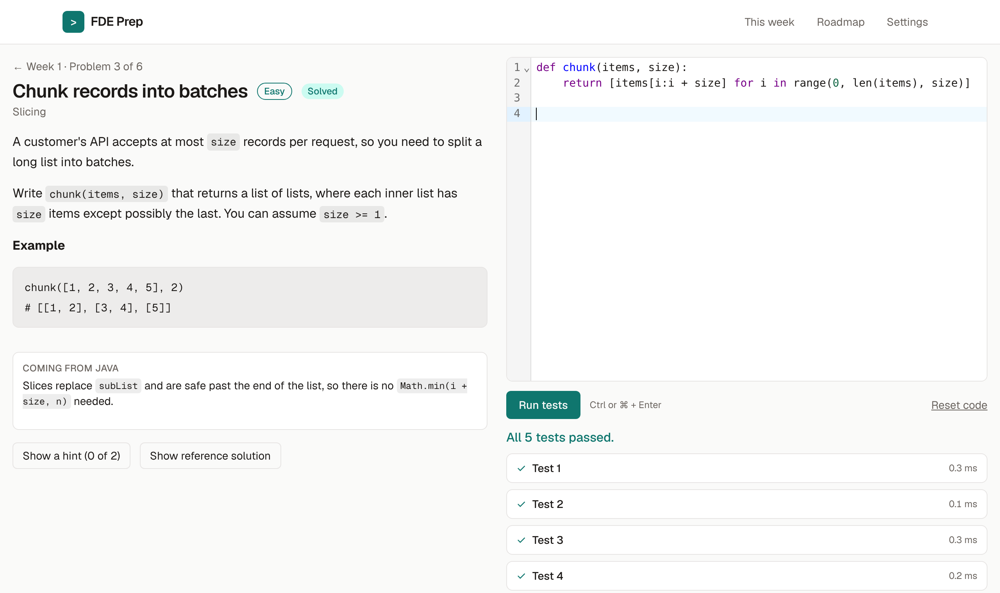

# FDE Prep

A personal practice site for Forward Deployed Engineer (FDE) interviews. It follows a 26-week study plan and opens a new set of coding problems and hands-on tasks every Monday, so the question each week is "what do I do now?" and not "what should I study?".



## Contents

- [What this project is for](#what-this-project-is-for)
- [Features](#features)
- [Tech stack](#tech-stack)
- [Run it locally](#run-it-locally)
- [How the code works](#how-the-code-works)
- [Project layout](#project-layout)
- [Add a problem](#add-a-problem)
- [Deploy](#deploy)
- [Limitations and next steps](#limitations-and-next-steps)

## What this project is for

Forward Deployed Engineers embed with customers and build software against messy, real-world problems. Their interviews reflect that. Compared with a standard software engineering loop, they put less weight on puzzle problems and more on four things:

1. **Practical coding** in Python: parsing, cleaning data, calling APIs.
2. **System and data design** for enterprise environments.
3. **Decomposition**: structuring a vague customer problem out loud.
4. **Customer skills**: scoping, explaining tradeoffs, staying calm when things break.

General practice sites cover only the first item, and they offer thousands of problems with no schedule. This site is the opposite. It is a single fixed curriculum, built for one person returning to hands-on coding after time away, that covers all four areas and releases work one week at a time.

The plan has four phases:

| Phase | Weeks | Goal |
| --- | --- | --- |
| 1. Coding re-entry | 1 to 6 | Write Python without looking things up and solve easy problems in under 15 minutes |
| 2. Patterns and practical building | 7 to 14 | Handle most medium problems and ship a data pipeline and a first LLM feature |
| 3. Design, AI systems, and a portfolio project | 15 to 20 | Deploy one project that looks like real FDE work |
| 4. Interview loops and applications | 21 to 26 | Timed mocks every week and applications out |

Each week has three parts: a set of coding problems solved on the site, a **build task** done in your own environment (for example "build a small FastAPI service with 3 endpoints"), and a **design or customer task** (for example a written decomposition case). The site runs and grades the coding problems, and tracks the other two as checkboxes.

## Features

- **Weekly dashboard.** The home page shows the current week's problems and tasks, with totals for problems solved, tasks finished, and your daily streak.
- **Locked future weeks.** A week opens on its Monday. The roadmap page shows all 26 weeks with a progress bar for each one that is open.
- **In-browser Python.** Solutions run against test cases entirely in the browser. There is no server to send code to.
- **FDE-style problems.** Problems are framed as the work the role involves, such as cleaning a customer's export, reconciling two ledgers during a migration, or parsing a legacy config format.
- **Graduated help.** Each problem has hints that reveal one at a time. The reference solution unlocks after you solve the problem or use every hint. Week 1 problems include a "Coming from Java" note.
- **Saved work.** Code drafts are saved as you type, and progress survives a page reload.
- **Settings.** Change the start date, unlock every week, or reset all progress.

## Tech stack

| Piece | Choice | Why |
| --- | --- | --- |
| Framework | [Next.js](https://nextjs.org) App Router, TypeScript | Static prerendering of every page, with typed routes and data |
| Styling | Tailwind CSS | Small design-token set in `globals.css`, with light and dark themes that follow the system |
| Editor | [CodeMirror 6](https://codemirror.net) | Lightweight, with Python syntax highlighting |
| Python runtime | [Pyodide](https://pyodide.org) | CPython compiled to WebAssembly, so real Python runs in the browser |
| Storage | Browser `localStorage` | No backend or accounts needed |
| CI | GitHub Actions | Verifies problems, lints, and builds on every push |

## Run it locally

Requires Node.js 20 or newer. Python 3 is needed only for `npm run verify`.

```bash
npm install
npm run dev
```

Then open http://localhost:3000.

| Command | What it does |
| --- | --- |
| `npm run dev` | Start the development server |
| `npm run build` | Production build |
| `npm run start` | Serve the production build |
| `npm run lint` | ESLint |
| `npm run verify` | Run every problem's reference solution against its tests |

`dev` and `build` first run two small scripts. `scripts/copy-pyodide.mjs` copies the Pyodide runtime from `node_modules` into `public/pyodide/`, and `scripts/build-problem-index.mjs` builds the problem index. Both outputs are git-ignored.

## How the code works

The app has no backend. Everything below happens in the browser, on top of pages that were rendered to static HTML at build time.

### 1. Content is data, not code

The curriculum and the problems are plain data, kept apart from the interface.

- `src/data/curriculum.ts` holds the four phases and all 26 weeks. Each week has a title, a coding focus, a build task, and a design or customer task.
- `content/problems/*.json` holds one file per coding problem.
- `scripts/build-problem-index.mjs` combines those files into one generated JSON index before each `dev` or `build`.
- `src/data/problems.ts` imports that index, gives it a `Problem` type, and exposes `getProblem(id)` and `problemsForWeek(n)`.

A problem file looks like this (shortened):

```json
{
  "id": "w01-chunk-records",
  "week": 1,
  "order": 3,
  "title": "Chunk records into batches",
  "difficulty": "easy",
  "topic": "Slicing",
  "functionName": "chunk",
  "description": "Markdown problem statement...",
  "starterCode": "def chunk(items, size):\n    pass\n",
  "tests": [
    { "args": [[1, 2, 3, 4, 5], 2], "expected": [[1, 2], [3, 4], [5]] }
  ],
  "hints": ["First hint...", "Second hint..."],
  "javaTip": "Optional note for Java developers",
  "solution": "def chunk(items, size):\n    return [...]\n"
}
```

`week` decides when the problem unlocks, and `order` sets its position within the week. Each test calls `functionName` with `args` and compares the return value to `expected`.

### 2. Pages and routing

Routes live in `src/app/`:

| Route | File | Shows |
| --- | --- | --- |
| `/` | `page.tsx` | Dashboard for the current week |
| `/roadmap` | `roadmap/page.tsx` | All 26 weeks grouped by phase |
| `/week/[n]` | `week/[n]/page.tsx` | One week's problems and tasks |
| `/problems/[id]` | `problems/[id]/page.tsx` | The problem workspace |
| `/settings` | `settings/page.tsx` | Start date, unlock, reset |

The page files are server components. They look up static data and hand it to a client component from `src/components/`. The two dynamic routes export `generateStaticParams`, so Next.js prerenders a page for every week and every problem at build time.

Anything that depends on the visitor, meaning their progress or today's date, cannot be known at build time. Those parts are client components that render a placeholder first and fill in once the page is running in the browser.

### 3. Weekly unlocking

`src/lib/schedule.ts` contains the date logic as small pure functions.

`currentWeekNumber(startDate, today)` counts the whole days between the start date and today, divides by 7, and clamps the result to the range 1 to 26. Before the start date it returns week 1, so there is always something to work on. Dates are handled as `YYYY-MM-DD` strings and converted to UTC midnight for the arithmetic, which keeps daylight saving changes from shifting a week boundary.

`src/components/LockGate.tsx` wraps the week and problem pages. It renders its children only if the week number is at or below the current week, or if "Unlock every week" is on in Settings. Otherwise it shows a lock screen with the date the week opens.

The lock is a pacing aid and not a security boundary. All content ships to the browser, which is fine for a personal study tool.

### 4. Progress storage

`src/lib/progress.ts` is a small store over `localStorage`. It keeps one JSON object under the key `fde-prep:progress:v1`:

```ts
type Progress = {
  startDate: string;                 // first Monday of the plan
  unlockAll: boolean;                // Settings toggle
  solved: Record<string, string>;    // problem id -> date first solved
  tasks: Record<string, boolean>;    // "w3-build" -> done
  activity: Record<string, number>;  // "2026-11-16" -> items finished that day
};
```

Components read it with the `useProgress()` hook, which is built on React's `useSyncExternalStore`. That hook does two useful things here. On the server and during the first browser render it returns an empty default, so the server HTML and the browser's first render match. After that it returns the stored value and re-renders every subscribed component whenever the store changes, including changes made in another tab.

Writes go through `progressActions` (`markSolved`, `toggleTask`, `setStartDate`, `setUnlockAll`, `reset`). Marking a problem solved or ticking a task also adds one to today's entry in `activity`. `currentStreak()` in `schedule.ts` walks backward from today through `activity` and counts consecutive days.

Code drafts are stored separately, one key per problem (`fde-prep:draft:<id>`), so typing in the editor does not rewrite the whole progress object.

### 5. Running a solution

This is the core of the site. Four files are involved:

```
Workspace.tsx  ->  runner.ts  ->  py-worker.js  ->  harness.py
 (the page)      (page side)     (web worker)      (Python)
```

Step by step, when you click **Run tests**:

1. **`src/components/Workspace.tsx`** calls `runTests(code, functionName, tests)` with the editor's contents.
2. **`src/lib/runner.ts`** owns a single web worker, created on first use. It posts the code and tests to the worker and returns a promise for the report. Opening a problem page calls `warmUpPython()`, which starts the worker early so Python is already downloading while you read the problem.
3. **`public/py-worker.js`** runs off the main thread. On its first message it loads Pyodide from `/pyodide/`, fetches `/harness.py`, writes it into Pyodide's in-memory file system, and imports it. It then posts a `started` message and calls `harness.run_tests(...)`.
4. **`public/harness.py`** is ordinary Python. It executes your code with `exec` into a fresh namespace, looks up the function by name, and calls it once per test. For each test it captures anything you print, times the call, and catches any exception. It returns a JSON report.
5. The worker posts the report back. `runner.ts` resolves its promise, and `Workspace.tsx` renders one row per test showing the call, the expected value, what your code returned, and any printed output or error. If every test passed, it calls `progressActions.markSolved`.

A few details in that flow are worth knowing:

- **Why a worker.** Python execution is synchronous. On the main thread, a slow solution would freeze the page, and an infinite loop would freeze it for good. In a worker, the page stays responsive.
- **Stopping infinite loops.** When `runner.ts` receives `started`, it begins a 10-second timer. If no report arrives in time, it calls `worker.terminate()`, reports a timeout, and creates a fresh worker on the next run. Terminating the worker is the only reliable way to stop running WebAssembly from outside.
- **Comparing results.** The harness passes each return value through `json.dumps` and `json.loads` before comparing it to `expected`. This makes a tuple equal to a list and turns a set into a sorted list, so tests check the answer and not the container type.
- **Readable errors.** The harness compiles your code under the file name `solution.py` and filters tracebacks down to frames from that file. You see `line 4, in chunk` and the error, without the harness's own frames.
- **Fresh inputs.** Arguments are deep-copied for each test, so a solution that mutates its input cannot affect later tests.
- **Self-hosted runtime.** Pyodide is served from the site's own `/pyodide/` folder and not from a CDN, so the site keeps working if a third-party host is down or blocked.

### 6. Checking the problems themselves

`scripts/verify_problems.py` loads the same `public/harness.py` that the browser uses and, for every problem file, checks that:

- all required fields are present and `id` matches the file name,
- the reference solution passes every test, and
- the starter code does not already pass every test.

Because the script and the browser share one harness, a problem that verifies locally behaves the same way on the site. CI runs this script on every push, along with lint and a production build.

## Project layout

```
content/problems/         One JSON file per problem
public/
  harness.py              Python test harness (browser and verify script)
  py-worker.js            Web worker that loads Pyodide and runs the harness
  pyodide/                Pyodide runtime, copied at build time (git-ignored)
scripts/
  copy-pyodide.mjs        Copies Pyodide out of node_modules
  build-problem-index.mjs Combines content/problems into one index
  verify_problems.py      Checks every problem's solution against its tests
src/
  app/                    Routes and the root layout
  components/
    Dashboard.tsx         Home page: stats and the current week
    WeekView.tsx          A week's problem list and task checkboxes
    Roadmap.tsx           All weeks with lock state and progress bars
    LockGate.tsx          Hides weeks that have not opened yet
    Workspace.tsx         Problem statement, editor, and test results
    Settings.tsx          Start date, unlock toggle, reset
    DifficultyBadge.tsx   Easy, medium, hard label
  data/
    curriculum.ts         Phases and the 26 weeks
    problems.ts           Typed index over content/problems
  lib/
    progress.ts           localStorage store and hooks
    schedule.ts           Week and streak date math
    runner.ts             Page-side client for the Python worker
.github/workflows/ci.yml  Verify, lint, build
```

## Add a problem

1. Create `content/problems/<id>.json`, using an existing file as a template. The `id` must match the file name. By convention ids start with the week, as in `w03-...`.
2. Run `npm run verify`.

The problem index is rebuilt from the folder each time you run `dev` or `build`, so there is nothing to register by hand.

Test arguments and expected values must be valid JSON. That means no tuples, sets, or non-string dictionary keys in `expected`. Return a list or a string-keyed dictionary from the reference solution.

## Deploy

The site has no server-side state, so the simplest route is [Vercel](https://vercel.com/new): import this repository and accept the defaults. The `prebuild` script copies Pyodide into place during the build.

## Limitations and next steps

- **Progress lives in one browser.** There are no accounts and no database, so progress does not sync between devices and is lost if you clear site data. Adding sign-in and a small database (for example GitHub login with Supabase) would fix this and is the natural next feature.
- **Problem sets exist for weeks 1 to 6.** Later weeks show their focus topic and tasks, with problems still to be written.
- **Standard library only.** Solutions can import anything in Python's standard library. Third-party packages such as `numpy` are not loaded.
- **Single-function problems.** Every problem tests one function with JSON inputs and outputs, so linked lists are represented as nested dictionaries. Class-based problems, such as an LRU cache, will need a small extension to the harness.
